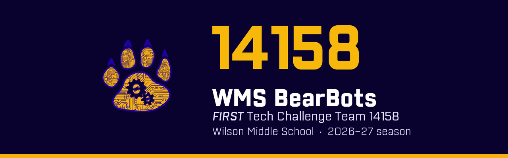

# FTC 14158 robot code · BIOBUZZ 2026–27

[](https://github.com/Wyandotte-Robotics/ftc-14158-biobuzz/actions/workflows/build.yml)

Robot code for the **WMS BearBots**, *FIRST* Tech Challenge Team 14158 at Wilson Middle School, for the 2026–27 BIOBUZZ season. Part of [Wyandotte Robotics](https://github.com/Wyandotte-Robotics).

## What's inside

| | Version | What it's for |
| --- | --- | --- |
| [FTC SDK](https://github.com/FIRST-Tech-Challenge/FtcRobotController) | 12.0 | The official *FIRST* robot controller app |
| [Pedro Pathing](https://pedropathing.com/docs) | 3.0.2 | Follows paths in autonomous, and knows where the robot is on the field |
| Pedro Pathing AutoTune | 1.0.2 | A web page on the robot that walks you through tuning Pedro |
| [Panels](https://panels.bylazar.com) | 1.0.18 | A dashboard in your browser: live field view, telemetry, graphs, and values you can tune live |

## Your first day

1. **Install [Android Studio](https://developer.android.com/studio)** (Narwhal 3 Feature Drop or newer).
2. **Get the code.** In Android Studio, choose **File → New → Project from Version Control** and paste `https://github.com/Wyandotte-Robotics/ftc-14158-biobuzz.git`. Or clone it with GitHub Desktop and open the folder.
3. **Wait for Gradle sync.** The first time downloads a lot and can take several minutes.
4. **Connect to the robot.** Join the Control Hub's Wi-Fi (or plug in USB), choose **TeamCode** at the top, and press **Run ▶**.
5. **Drive.** On the Driver Hub, pick **Main TeleOp** and press Play.

`Main TeleOp` expects drive motors named `frontLeft`, `frontRight`, `backLeft` and `backRight`. Either use those names in your robot configuration, or change them at the top of [`MainTeleOp.java`](../TeamCode/src/main/java/org/firstinspires/ftc/teamcode/opmodes/MainTeleOp.java).

## Where things go

```
TeamCode/src/main/java/org/firstinspires/ftc/teamcode/
├── opmodes/   Your TeleOps and autonomous routines (MainTeleOp is the starter drive code)
├── pedro/     Pedro Pathing setup: Constants.java, Tuning.java and the tuners
├── tools/     Field Viewer: drive and watch the robot on the Panels field
└── util/      FieldDrawing: draws the robot and its paths on Panels
```

Leave `FtcRobotController/` alone. That's *FIRST*'s code, and SDK updates replace it.

## Dashboards on the robot

Connect your laptop to the robot's Wi-Fi, then open:

| Page | Address | Use it to |
| --- | --- | --- |
| **Panels** | http://192.168.43.1:8001 | Watch the robot on the field, see telemetry and graphs, tune values live |
| **Pedro AutoTune** | http://192.168.43.1:10158 | Tune Pedro Pathing step by step |
| Robot Controller | http://192.168.43.1:8080 | Manage the configuration, read logs, use OnBot Java |

## Setting up Pedro Pathing

Pedro needs to learn about your drivetrain and localizer (odometry pods, Pinpoint, OTOS…) before it can follow paths. Until then, `Constants.create()` returns `null` and the Field Viewer will say so. Do this once the drivetrain and localizer are on the robot:

1. **Install the code** on the robot and open **AutoTune** (http://192.168.43.1:10158).
2. **Run the Mecanum Tuner.** Paste the code it gives you into [`pedro/Constants.java`](../TeamCode/src/main/java/org/firstinspires/ftc/teamcode/pedro/Constants.java).
3. **Run the tuner for your localizer** (Pinpoint, OTOS, two wheel, three wheel or OctoQuad). Paste that code into `Constants.java` too.
4. **Turn on the Foresight Tuner** in [`pedro/Tuning.java`](../TeamCode/src/main/java/org/firstinspires/ftc/teamcode/pedro/Tuning.java) (it's commented out), reinstall, run it, and paste its code.
5. **Make `create()` return a real `Follower`.** There's an example in the comment.
6. **Check it with the Field Viewer.** Open Panels, run **Field Viewer** from the TeleOp list, and drive. The gold circle on the field should move just like the robot does.

The full guide is at [pedropathing.com/docs/pathing/tuning](https://pedropathing.com/docs/pathing/tuning).

## Updating the FTC SDK

*FIRST* releases SDK updates during the season. This repo keeps the SDK's history, so updates merge cleanly:

```bash
git remote add upstream https://github.com/FIRST-Tech-Challenge/FtcRobotController.git
git fetch upstream --tags
git merge v12.1   # use the newest release tag
```

Do it on a branch, make sure it builds, and open a pull request like any other change. Check for newer Pedro Pathing and Panels versions in `build.dependencies.gradle` at the same time.

## How we work

Read the [contributing guide](https://github.com/Wyandotte-Robotics/.github/blob/main/CONTRIBUTING.md) before your first change. The short version:

- Make a branch, open a pull request, get a review. Never commit straight to `main`.
- Every pull request gets an automatic build check. Fix it if it goes red.
- Only code from `main` goes on the robot at competitions.
- No passwords, student last names, contact details or photos. This repo is public.

## Credits

Built on the [FTC SDK](https://github.com/FIRST-Tech-Challenge/FtcRobotController) by *FIRST* ([license](../LICENSE)), [Pedro Pathing](https://github.com/Pedro-Pathing), and [Panels](https://panels.bylazar.com) by Lazar.
